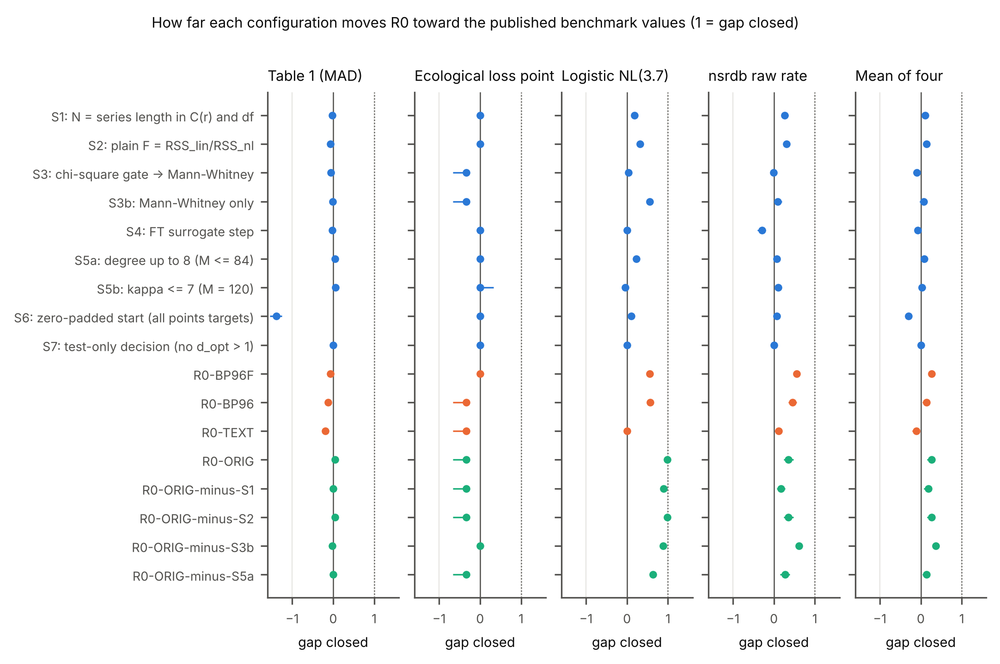
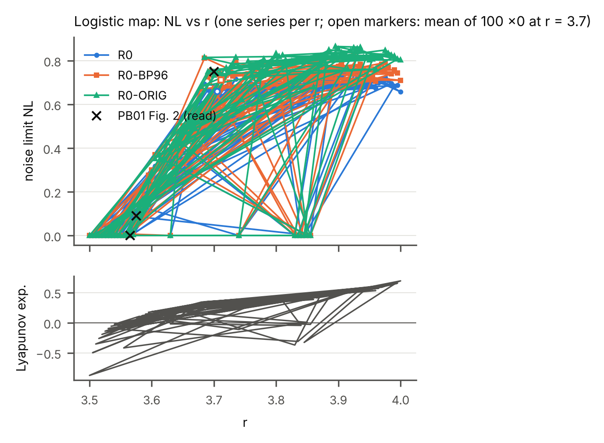
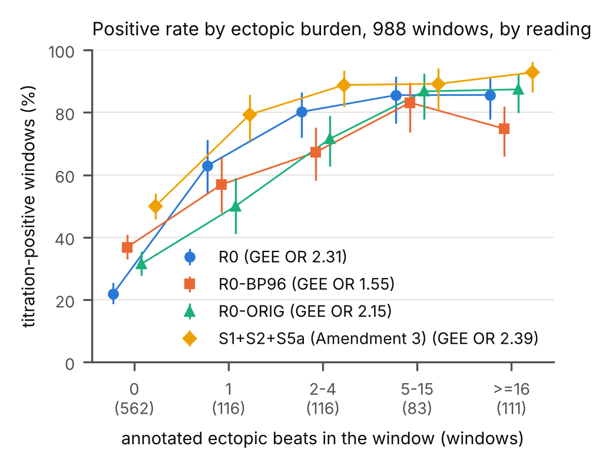
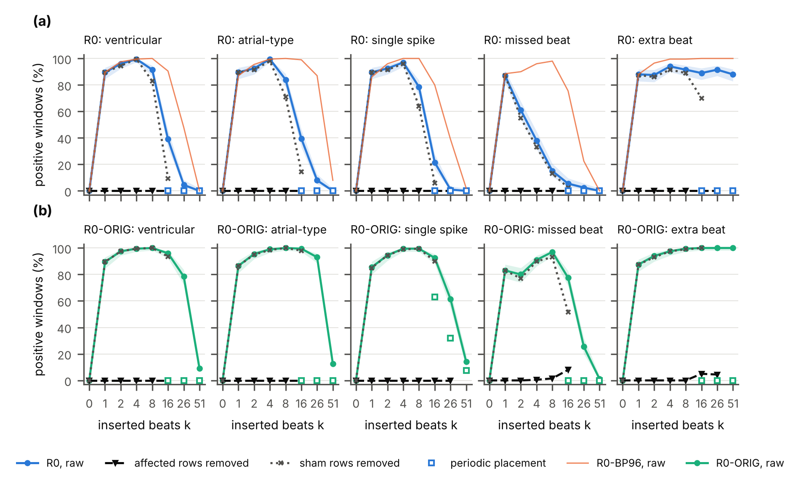
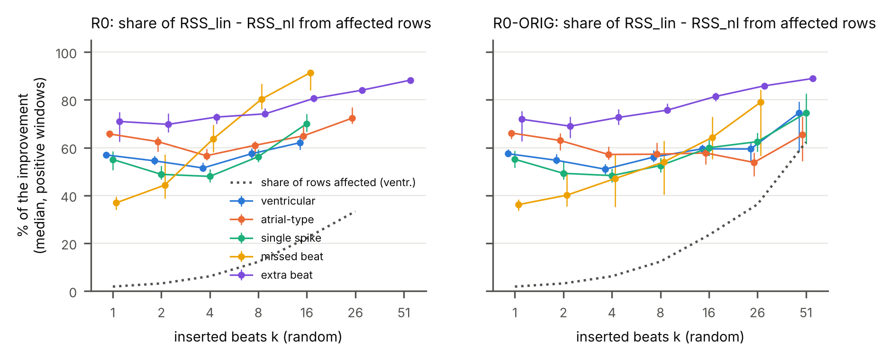
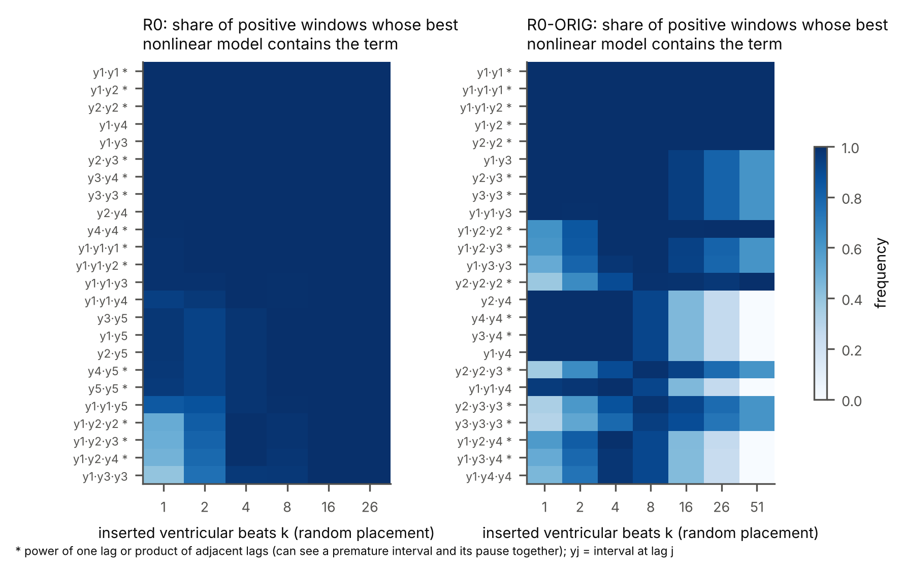
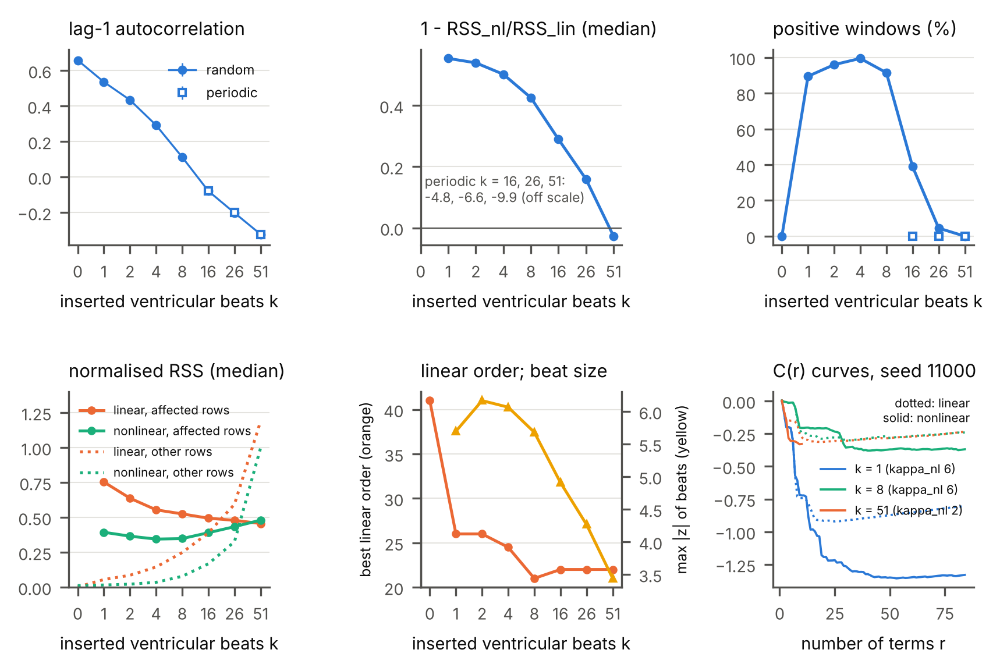

# Revision analyses M1 and M2: report

**EXPLORATORY, POST HOC.** These analyses answer a mock referee report. They were planned after every database and
design had been analysed in Phases 10-12, so none of them is confirmatory.

**Names used in the paper.** The configuration called "R0-ORIG minus S3b" or "S1 + S2 + S5a" here is called
R0-BP96F-d8 in the paper (N = series length, plain F ratio, polynomial degree up to 8 within the 84-term limit).
All other reading names (R0, R0-BP96F, R0-BP96, R0-S-FT, R0-S-AAFT, R0-ORIG) are the same in both.

- **Plan:** `analyses/revision_m1_m2/PLAN.md`, commit **6166ef7**, **2026-11-17T15:23:47Z**, written and pushed before
  any run. Amendments: 1 (4e137ea, 16:01Z: verification controls for every configuration), 2 (f863043, 16:42Z: R0-ORIG
  composition by the fixed rule), 3 (0828bd2, 18:47Z: headline under R0-ORIG without S3b), 4 (170a469, 18:49Z:
  verification of that configuration; AF for stored readings). Each states what had been seen when it was written.
- **Branch:** `revision-m1-m2` (mirrored to `claude/confident-brahmagupta-535f2i`). No preregistration, locked script
  or stored result was changed. The runner refused to start unless PLAN.md was committed and pushed.
- **Regression check:** with every switch at its default the new code reproduces R0 bit for bit (14 tests, against
  the frozen code and stored Phase 10-12 outputs). The full recomputation agreed with every stored R0 decision:
  988/988 windows in each arm, 1,756/1,756 transplant decisions, 8,993/8,993 segments in each arm, 1,650/1,650 PM97
  segments, 800/800 exploratory dose windows; R0-BP96 988/988 windows and 1,650/1,650 PM97 segments.
- **Uncertainty:** Wilson 95 % CIs for proportions, subject-cluster bootstrap (10,000 resamples) for human data,
  bootstrap over seeds for benchmark medians and means, robust Wald CIs for GEE and conditional logit.
- **Inputs:** manuscript FINAL_DRAFT_4 (the supplement was not provided; FIDELITY.md and the Phase 10-12 reports stood
  in for it), BP96, PM97 (both in git-ignored `private_inputs/`), PB01 (PMC34630).

## Bottom line

1. **What explains the sensitivity gap.** Only part of it is explained, by two of the original test's conventions:
   N = series length in the criterion (S1) and the plain F ratio (S2). Together they raise the healthy nsrdb rate
   from 52.6 % to 79.0 % and the logistic NL(3.7) from 0.660 to 0.710. Allowing polynomial degree up to 8 adds a
   little (S1 + S2 + S5a: 81.8 %, 0.740). With the Mann-Whitney test as well (R0-ORIG), NL(3.7) reaches 0.751, the
   published value. **No configuration closes the ecological-model gap** (best 35 % against ~50 %), **none brings
   Table 1 beyond 6 of 9 systems**, and **none reaches "nearly 100 %" on nsrdb** (best 81.8 %). R0 is not uniformly
   less sensitive: on Table 1 it is more noise-tolerant than BP96 for two of its four misses.
2. **Claims that hold under every reading** (R0, R0-BP96, R0-ORIG, S1 + S2 + S5a, and the stored Phase 12 readings
   where they exist): couplets make 100/100 linear windows positive and runs 96/100; the burden OR is above 1
   (GEE 1.55-2.52; within subjects 1.75-3.40); one inserted premature beat adds 28-64 points; with burden in the
   model there is no separate CHF effect; on nsr2db / chf2db there is no CHF - healthy difference after editing or
   Wu-style deletion; PM97's raw pattern is not reproduced, and CHF is lower after handling (26-65 points); the
   static warp N5 is positive in 100/100.
3. **Claims that do not hold under every reading.** "In heart rate, titration mainly detects ectopic beats": the
   share of positive windows attributable to ectopy is 52 % under R0 but 24-41 % under every other reading except
   the FT-surrogate one (64 %); under the configuration closest to the published benchmarks it is 24 %, because half
   of the ectopy-free windows are already positive. After masking, CHF segments on chf2db were *less* often positive
   than healthy ones under that configuration (-12.0 points [-23.6, -0.02]; edited and Wu-style arms showed no
   difference). "One ectopic beat nearly tripled the chance" (2.9x under R0, 1.5-1.6x under the
   original's conventions). "Isolated beats rarely trigger titration" (5 % isolated beats: 5/100 under R0, 57 and
   82/100 under R0-BP96 and R0-ORIG). Replacement wording is in `claims_check.md` and below.
4. **Why one beat flips the test: leverage.** A premature beat enters about 8 of the 429 regression equations.
   Squares and products of the first lags are near zero except at the beat, so the polynomial fits those equations
   almost exactly (leverage 0.999, Cook's distance ~900 against 0.03). They are 1.9 % of the rows but carry 57 % of
   the drop in residual sum of squares. Removing them makes 100 % of positive windows negative; removing as many
   other equations makes 3 % negative. A beat that falls before the first fitted equation never made a window
   positive (0/19, against 179/181 when it fell inside).
5. **Why the inverted U: the polynomial runs out of capacity, and the linear model absorbs the rest.** With more
   beats, the polynomial can no longer interpolate every affected equation (leverage 0.98 at 8 beats, 0.41 at 26)
   and its error on them rises; the linear model learns part of the short-long alternation (lag-1 autocorrelation
   +0.11 to -0.32); and the beats become less extreme in SD units. Periodic beats are absorbed completely by the
   83-lag linear model (0 % positive from 16 beats). Under the original conventions the downslope moves to higher
   densities (26 beats: 78 % positive under R0-ORIG against 4.5 % under R0), so the "far side of the inverted U" in
   Table III is partly a property of R0's conventions.

## M1.1 Deviations (`deviations.csv`, `deviations.md`)

32 rows: every way R0 differs, or might differ, from BP96, PM97 and PB01, with the original's wording, R0's choice,
the closest alternative, my confidence about what the original did, and the switch that tests it. Points where R0
matches the original with high confidence (eps as a normalised RMS, one-sided test, 1 % level, matched linear and
nonlinear term counts, PB01's titration scheme: white unit-variance noise, NL = alpha/sigma_y, bisection, 10
realisations) have no switch. Nine deviations were switchable (S1-S7, with two two-option groups) plus one benchmark
protocol (P1, sampling of flows).

| Switch | Deviation it removes | Confidence about the original | Composite closure [95 % CI] |
|---|---|---|---|
| S1 | N = series length in C(r) and df (D1, D3) | high | +0.10 [+0.08, +0.13] |
| S2 | plain F ratio (D2) | high | +0.14 [+0.13, +0.17] |
| S3 | chi-square gate with Mann-Whitney fallback (D6) | medium | -0.09 [-0.19, -0.08] |
| S3b | Mann-Whitney test always (D7) | low-medium | +0.08 [-0.03, +0.10] |
| S4 | FT surrogate step (D8) | high that it existed, medium on its form | -0.08 [-0.11, -0.05] |
| S5a | degree up to 8, M <= 84 (D11) | medium | +0.09 [+0.07, +0.10] |
| S5b | kappa <= 7, M = 120 (D12) | low-medium | +0.03 [+0.02, +0.12] |
| S6 | zero-padded start, every point a target (D16) | low | -0.30 [-0.34, -0.26]; fails verification |
| S7 | decision by the test alone (D17) | medium | 0.00 (identical to R0) |
| P1 | sampling step of flows chosen as in BP96 (D25) | medium | -0.03 (Table 1 only: -0.11) |

Composite closure: the mean over the four benchmarks of the fraction of R0's gap to the published value that the
switch closes (1 = closed, negative = moves away).

## M1.2 Ablation on the benchmarks (`ablation_benchmarks.csv`, `ablation_table1_by_system.csv`)



*Figure 1.* Each switch's closure of R0's gap on each benchmark. The logistic and nsrdb gaps move toward the published
values under the N and F conventions of the original; the ecological and Table 1 gaps do not move under any switch.

**Benchmarks (100 seeds or initial conditions per synthetic setting; 18 nsrdb subjects).**

| Configuration | Table 1 MAD (pp) [CI]; within 15 pp | Ecological loss point | Logistic NL(3.7) | nsrdb raw 500-beat rate | Composite |
|---|---|---|---|---|---|
| published | 0 | ~50 % | ~0.75 | "nearly 100 %" | 1 |
| R0 | 14.6 [14.2, 15.1]; 5/9 | 35 % [35, 35] | 0.660 [0.657, 0.663] | 52.6 % [43.5, 61.9] | 0 |
| S1 N = length | 14.9; 5/9 | 35 % | 0.676 | 65.0 % | +0.10 |
| S2 plain F | 15.5; 5/9 | 35 % | 0.689 | 67.5 % | +0.14 |
| S3 chi-square gate | 15.3; 6/9 | 30 % | 0.663 | 52.2 % | -0.09 |
| S3b Mann-Whitney | 14.7; 6/9 | 30 % | 0.711 | 57.2 % | +0.08 |
| S4 FT surrogates | 14.8; 5/9 | 35 % | 0.660 | 39.2 % | -0.08 |
| S5a degree <= 8 | 13.8; 5/9 | 35 % | 0.680 | 56.0 % | +0.09 |
| S5b kappa <= 7 | 13.8; 6/9 | 35 % | 0.656 | 57.8 % | +0.03 |
| S6 zero padding | 34.8; 4/9 | 65 % (censored) | 0.670 | 56.2 % | -0.30 |
| S7 test only | 14.6; 5/9 | 35 % | 0.660 | 52.6 % | 0.00 |
| R0-BP96F (S1+S2) | 15.6; 5/9 | 35 % | 0.710 | 79.0 % [72.8, 84.7] | +0.26 |
| R0-BP96 (S1+S2+S3) | 16.3; 5/9 | 30 % | 0.711 | 74.3 % | +0.14 |
| R0-TEXT (S1+S2+S3+S4) | 17.4; 5/9 | 30 % | 0.660 | 58.1 % | -0.10 |
| **R0-ORIG (S1+S2+S3b+S5a)** | 13.9 [13.5, 14.3]; 6/9 | 30 % [25, 30] | **0.751 [0.747, 0.756]** | 69.6 % [60.7, 78.2] | +0.26 [+0.15, +0.29] |
| R0-ORIG minus S1 | 14.6; 6/9 | 30 % | 0.740 | 60.7 % | +0.18 |
| R0-ORIG minus S2 | identical to R0-ORIG (S3b replaces the F-test) | | | | +0.26 |
| **R0-ORIG minus S3b (S1+S2+S5a)** | 14.8; 5/9 | 35 % | 0.740 | **81.8 % [75.7, 87.4]** | **+0.37 [+0.35, +0.40]** |
| R0-ORIG minus S5a | 14.6; 6/9 | 30 % | 0.718 | 65.4 % | +0.14 |

*Table 1.* Benchmark values by configuration (CIs in `ablation_benchmarks.csv`). The combination that explains most
of the gap is S1 + S2 + S5a (composite +0.37); even it leaves nsrdb at 82 % and the ecological model at 35 %.

- **Ecological model (BP96 Fig. 1d).** Under R0, 89 % of seeds were still detected at 25 % noise, 36 % at 35 % and none
  at 50 %. At noise levels near the loss point the F-test, not the information criterion, is the binding condition
  (S7 changes nothing), and the plain F or N = length change F by a few percent only. The Mann-Whitney test loses
  power under noise (30 %). Only zero padding moved the loss point, past 60 % (see below).
- **Table 1.** With 100 seeds, R0 misses the same four systems as Phase 12: ecological 32.4 (50), Grebogi non-chaotic
  attractor 41.4 (25), Rossler 27.3 (75), Lorenz 68.0 (50). Two misses are in the direction of R0 being *more*
  noise-tolerant than BP96. No switch moved Rossler toward 75. P1 (coarser sampling, as BP96 describes) made
  Mackey-Glass tau = 100 detectable (53 against Table 1's 15) and Lorenz closer (57.8), but not Rossler (25.8); three
  of four chosen steps were at the edge of the grid. The flow gaps probably come from unreported sampling and
  parameters, not from the test.
- **Logistic NL(3.7).** The mean over 100 initial conditions is 0.660 under R0 (Phase 10's single series gave 0.637).
  The original's conventions move it to 0.71 and R0-ORIG to 0.751. This value was used in Phase 10 to choose R0's
  reading, so it is not an independent benchmark.
- **nsrdb.** The N and F conventions together add 26 points (52.6 % to 79.0 %); the surrogate step removes 13.
- **Zero padding (S6) fails verification.** It calls every periodic and quasiperiodic control nonlinear (20/20 limit
  cycle, 2-torus, period-3 logistic) and makes the ecological model survive 200 % noise in Table 1. BP96 reports that
  periodic series were not flagged, so zero padding is unlikely to be how the original handled the first points.
- **Verification (Amendment 1; `verification_by_config.csv`).** Every configuration except S6 passes Phase 10's V1-V6,
  including R0-ORIG (V1 NL 0.733, V4 Spearman 0.87, all controls negative).



*Figure 2.* Logistic-map NL versus r for R0, R0-BP96 and R0-ORIG (one series per r, Phase 10 seeds; open markers: mean
of 100 initial conditions at r = 3.7). R0-ORIG reaches PB01's NL at r = 3.7 and gives NL = 0 at 17 of 18 periodic parameters (R0: 18 of 18).

## M1.3 Headline results by reading (`headline_by_reading.csv`)

| Quantity | R0 | R0-BP96 | R0-ORIG |
|---|---|---|---|
| Positive rate, burden 0 / 1 / 2-4 / 5-15 / >= 16 (%) | 21.9 / 62.9 / 80.2 / 85.5 / 85.6 | 36.8 / 56.9 / 67.2 / 83.1 / 74.8 | 31.5 / 50.0 / 71.6 / 86.7 / 87.4 |
| Rate ratio, 1 ectopic beat vs 0 | 2.88 | 1.54 | 1.59 |
| GEE OR per doubling of (1 + burden) | 2.31 [1.67, 3.19] | 1.55 [1.34, 1.80] | 2.15 [1.73, 2.68] |
| Within-subject OR (conditional logit, covariates) | 3.40 [2.62, 4.41] | 1.75 [1.45, 2.11] | 2.60 [2.03, 3.32] |
| CHF OR adjusted for burden | 0.77 [0.46, 1.28] | 0.85 [0.55, 1.31] | 0.67 [0.40, 1.14] |
| Attributable fraction of window positives (%) | 52.5 [42.7, 62.4] | 27.7 [19.4, 36.1] | 36.1 [27.0, 45.5] |
| GEE-based attributable fraction (%) | 41.9 [32.1, 55.1] | 23.0 [16.6, 30.7] | 35.8 [27.4, 44.7] |
| Transplant V0 -> V1 (%) | 22.1 -> 86.3 | 36.7 -> 64.5 | 30.5 -> 64.5 |
| Single ventricular beat, V1 - V0 (pp) | +64.2 [59.2, 69.3] | +27.8 [21.9, 33.6] | +33.9 [28.7, 39.3] |
| Atrial-type beat, V5 - V0 (pp) | +31.7 [26.4, 37.0] | -0.5 [-4.1, 3.2] | +7.3 [3.7, 11.1] |
| Couplet, V6 - V0 (pp) | +68.6 [63.4, 73.7] | +50.3 [44.8, 56.1] | +57.6 [52.0, 63.4] |
| Windows, CHF - NSR raw (pp) | +23.5 [12.6, 34.3] | +14.2 [4.6, 23.7] | +18.0 [6.6, 29.5] |
| Windows, masked / edited / Wu (pp) | +1.1 / +3.6 / +1.1 (all CIs include 0) | +1.9 / +1.4 / -2.3 (all include 0) | -6.5 / -1.7 / -2.9 (all include 0) |
| Segments, CHF - NSR raw (pp) | +22.4 [12.8, 31.7] | +22.3 [12.7, 31.8] | +26.7 [16.2, 36.8] |
| Segments, masked | -4.9 [-13.7, 4.3] | -7.1 [-15.9, 1.8] | -3.9 [-12.5, 5.1] |
| Segments, edited | +5.4 [-3.9, 14.7] | +2.2 [-6.9, 11.5] | +7.6 [-2.0, 17.4] |
| Segments, Wu-style | +2.9 [-5.3, 11.4] | +1.1 [-7.5, 9.8] | +6.4 [-2.5, 15.4] |
| Segment GEE OR per doubling | 1.99 [1.51, 2.62] | 1.66 [1.44, 1.90] | 2.01 [1.69, 2.38] |
| PM97 nsrdb raw 500 / 2,000 beats (%) | 52.6 / 81.7 | 74.3 / 74.4 | 69.6 / 76.1 |
| PM97 CHF - NSR raw, 500 beats (pp) | +16.5 [-1.9, 33.3] | -9.6 [-27.0, 7.0] | -3.4 [-22.3, 14.3] |
| PM97 CHF - NSR masked / edited / Wu (pp) | -45.6 / -26.4 / -27.9 (all CIs < 0) | -62.1 / -50.4 / -48.1 (all < 0) | -60.0 / -43.6 / -44.4 (all < 0) |
| PM97 within-subject OR per doubling of ectopy | 2.35 [1.78, 3.10] | 2.85 [2.09, 3.88] | 3.11 [2.24, 4.30] |
| PM97 segments without ectopy, CHF - NSR (pp) | -34.4 [-56.3, -6.1] | -54.1 [-76.2, -26.3] | -51.8 [-72.5, -24.2] |

*Table 2.* Headline results recomputed under each reading. Every ectopy effect keeps its direction and its CI excludes
the null under every reading; what changes is the baseline: under the original's conventions 31-50 % of ectopy-free
windows are already positive (R0-ORIG 31 %, R0-BP96 37 %, R0-BP96F 47 %, S1 + S2 + S5a 50 %), so the share of
positives attributable to ectopy falls.



*Figure 3.* Positive rate by ectopic burden in the 988 windows under each reading (including S1 + S2 + S5a, Amendment 3). The curves rise with burden under
every reading, but they start higher under the original's conventions.

**Synthetic nulls with ectopy (Table III; 100 linear windows per row; raw arm).**

| Condition | R0 | R0-BP96 | R0-ORIG |
|---|---|---|---|
| N1, no ectopy | 0 | 0 | 0 |
| Isolated 5 % / 10 % | 5 / 0 | 57 / 0 | 82 / 9 |
| Isolated 10 % with trend | 0 | 4 | 21 |
| Atrial-type 5 % / 10 % | 2 / 0 | 88 / 3 | 90 / 5 |
| Couplets 5 % / 10 % | 100 / 100 | 100 / 100 | 100 / 100 |
| Runs | 96 | 96 | 96 |
| Trigeminy / bigeminy | 0 / 0 | 0 / 0 | 0 / 0 |
| N5 static warp | 100 | 100 | 100 |
| Van der Pol, 6 regimes x 100: none / isolated 5 % / couplets 10 % / bigeminy (of 600) | 200* / 2 / 403 / 32 | 100 / 71 / 404 / 112 | 100 / 177 / 578 / 107 |

*Table 3.* Couplets and runs are positive under every reading; isolated and atrial-type beats at 5 % are not rare
under the original's conventions. *Noise-free decision; the van der Pol regime (rho, omega) = (6, 5.6) is positive
noise-free in all 100 windows but has NL = 0 under R0 titration, so Table III's titration count is 100 (see Notes).

**Sensitivity: S1 + S2 + S5a (Amendment 3).** Under S1 + S2 + S5a, the configuration closest to the published benchmarks
(verified: V1 NL 0.718, all controls negative), the ectopy effects hold: positive rate by burden 50.0 / 79.3 / 88.8 /
89.2 / 92.8 %; GEE OR 2.39 [1.60, 3.56]; within-subject OR 3.11 [2.30, 4.20]; CHF OR adjusted 0.91 [0.52, 1.59];
transplant 48.5 % -> 94.1 % (+45.6 [39.1, 52.2]); couplets 100/100, runs 96/100. The attributable fraction is 24.3 %
[17.4, 32.0] (GEE-based 23.0 %), because half of the ectopy-free windows are positive. Raw CHF excess: windows +17.9
[8.4, 27.2], segments +15.9 [7.9, 23.6]. After handling, windows show no difference (masked +7.3, edited +3.0, Wu
-1.1; all CIs include 0) and segments show none after editing (-2.6 [-13.5, 8.3]) or Wu-style deletion (-2.2
[-12.8, 8.5]), but **after masking CHF segments were less often positive (-12.0 [-23.6, -0.02], permutation p =
0.025; 27 CHF subjects)**. PM97 on nsrdb: healthy raw 81.8 % (2,000 beats: 88.3 %), CHF - NSR raw -7.5 [-22.9, 6.8],
after handling -65.2 / -46.2 / -45.5. This configuration also flags 30/100 windows of the step null N4 and 9/100 of
SETAR (R0: 10 and 0), so its higher sensitivity comes with more false positives on non-chaotic series that the V1-V6
controls do not contain.

## M1.4 Claims check (`claims_check.csv`, `claims_check.md`)

| Claim (where) | Holds under every reading? | Values | Suggested wording if not |
|---|---|---|---|
| Titration mainly detects ectopic beats (abstract, conclusions) | **no** | AF 52 % (R0), 28 % (R0-BP96), 36 % (R0-ORIG), 24 % (S1+S2+S5a), 26 % (R0-BP96F), 64 % (R0-S-FT), 41 % (R0-S-AAFT) | see below |
| Couplets: 100/100 under every version (abstract) | yes | 100/100 under all seven readings | - |
| 22 % -> 63 % from 0 to 1 ectopic beat (abstract, lead) | direction yes; numbers are R0's | 37 -> 57 (R0-BP96), 31 -> 50 (R0-ORIG), 50 -> 79 (S1+S2+S5a) | "rose from 22-50 % to 50-79 %, depending on the test's conventions" |
| One ectopic beat nearly tripled the chance (lead) | **no** | 2.9x (R0), 1.5-1.6x (R0-BP96, R0-ORIG, S1+S2+S5a, R0-BP96F), 3.6x (R0-S-FT) | "raised the chance 1.5- to 3.6-fold, depending on the conventions" |
| One inserted beat added 28-64 pp (abstract, conclusions) | yes | 27.8 to 64.2; R0-ORIG 33.9; S1+S2+S5a 45.6 | - |
| Raw CHF segments +22.4; after handling -4.9 to +5.4, n.s. (abstract) | **no** (masked arm under S1+S2+S5a) | raw > 0 under all; edited and Wu n.s. under all; masked -12.0 [-23.6, -0.02] under S1+S2+S5a | "after editing or deletion of ectopic beats the difference was -3 to +8 points (not significant) under every version; after masking it ranged from -12 to -4 points" |
| Raw window CHF excess +23.5 / +14.2 / +4.2 (Sec. V A) | no (known: AAFT) | R0-ORIG +18.0 [6.6, 29.5] | keep the current caveat |
| PM97 raw pattern not reproduced; CHF lower after handling, 26-46 pp (abstract) | yes | handled 26-65 pp lower across readings; nsrdb raw 500-beat rate 82 % and 2,000-beat 88 % under S1+S2+S5a | "(26-65 points lower, depending on conventions)" |
| Titration detects static transforms (abstract) | yes | N5 100/100 under all readings | - |
| Burden OR 2.31; within-subject 3.40 (conclusions) | yes (all CIs > 1) | GEE 1.55-2.52 (incl. stored R0-S-FT 2.52, R0-S-AAFT 1.70, R0-BP96F 2.10), within 1.75-3.40 | give the range |
| No CHF effect with burden in the model (Sec. V B) | yes | 0.67-0.91, all CIs include 1 | - |
| Isolated beats rarely triggered titration (Sec. IV A) | **no** | 5 % isolated: 5 (R0), 57, 82, 63; atrial 5 %: 2, 88, 90, 26 | see `claims_check.md` |
| 1-8 isolated beats made 91-99 % positive (conclusions) | yes for 1-8 beats | 90-100 % under R0 (200 windows), 90-100 % under R0-ORIG | the 26- and 51-beat values are R0's |

**Wording for the main claim that every reading supports.** Proposed for the abstract:

> "They do: in heart rate, ectopic beats are a major source of titration positives. One premature beat inserted into
> clean windows added 28-64 percentage points, and ectopic burden, not group, predicted a positive window under every
> version of the test I examined."

and for the conclusions: "A positive titration result for heart rate is evidence of nonlinearity. Ectopic beats
explain a large share of it (between a quarter and a half of positive windows, depending on the test's
conventions), and they explain the excess of positives in heart failure."

## M2 Why a single beat flips the test, and the inverted U (EXPLORATORY)

200 linear windows (N1, 512 intervals) per cell; k = 0-51 inserted beats of five types; random placement (and
periodic placement at k = 16, 26, 51). Decisions are noise-free; they agreed with the stored titration result in all
800 windows of Phase 11's exploratory dose-response that these runs repeat.



*Figure 4.* Positive rate versus k for each beat type under R0 (top) and R0-ORIG (bottom), with the rate after
removing the ectopy-affected equations (dashed; always about 0) and after removing as many other equations (dotted).
Removing the few affected equations abolishes the positives; the sham removal does not.

**Positive rate by k (ventricular, random placement; 200 windows).**

| k | 0 | 1 | 2 | 4 | 8 | 16 | 26 | 51 |
|---|---|---|---|---|---|---|---|---|
| R0 | 0 | 89.5 | 96.0 | 99.5 | 91.5 | 39.0 | 4.5 | 0 |
| R0-BP96 | 0 | 89.5 | 97.5 | 99.5 | 100 | 90.5 | 48.0 | 0 |
| R0-ORIG | 0 | 89.5 | 97.5 | 99.5 | 100 | 96.0 | 78.5 | 9.0 |

At k = 1 the beat fell before the first fitted equation in 19 of 200 windows; none of those was positive (0/19, CI
0-16.8 %), against 179/181 (98.9 %, CI 96.1-99.7 %) when it fell inside, under both R0 and R0-ORIG
(`m2_k1_position.csv`). By type (R0, k = 1, 2, 4, 8, 16, 26, 51): atrial 90, 92, 100, 84, 40, 8, 0; spike 90, 92, 97,
78, 22, 1, 0; missed beat 87, 61, 38, 15, 6, 2, 0; extra beat 88, 88, 94, 92, 89, 92, 88. Periodic placement gave 0 %
at k = 16, 26 and 51 for every type and reading except the random-sign spike (R0-ORIG 63, 32, 8 %).

**1. Few high-leverage equations (H2a; decision rule 6.4).** Pooled over k = 1-8 (R0): removing the affected equations
(about 8 per beat) made every positive window negative for every beat type (ventricular 753/753, CI 99.5-100 %),
while removing as many other equations made 2.8 % (21/753) negative (atrial 4.2 %, spike 4.6 %, missed 7.0 %, extra
1.9 %). Under R0-ORIG: 99.4-100 % against 0.0-2.7 %. **Verdict for every type and both readings: driven by a few
high-leverage equations.** At k = 1 the affected equations had nonlinear-model leverage 0.999 (median in positive
windows; other equations 0.036) and maximum Cook's distance 919 (median; others 0.028); 89.5 % of the 8 equations
with the largest Cook's distance were affected ones, and removing those 8 made 97.2 % of positive windows negative
(top 4: 40.8 %; top 1: 0 %). Removing the top 16 still sufficed at k = 2 (93.8 %) but not at k = 4 (38.2 %).

**2. Where the improvement comes from (`m2_ssr_share.csv`).** In positive windows (R0, ventricular) the affected rows
carried a median 56.9 % [55.8, 58.4] of RSS_lin - RSS_nl at k = 1 while being 1.9 % of the rows (31-fold
enrichment); 57.4 % at k = 8 (12.2 % of rows). Under R0-ORIG: 57.4 % at k = 1.



*Figure 5.* Median share of the residual-sum-of-squares drop that comes from ectopy-affected equations, by type and k,
against the share of rows that are affected (dotted). The share is far above the row share at small k for every type.

**3. Model anatomy (`m2_term_selection.csv`).** Because models are leading subsets, almost every positive window's best
nonlinear model contains all squares and products of lags 1-4 and the cubes y1^3, y1^2 y2 at every k. What changes
with k is how concentrated these terms are on the beat: at k = 1, 84 % of the sum of squares of y1^3 and 57 % of that
of y1^2 come from rows where lag 1 is the premature interval or the pause. Powers and products of adjacent lags are
the most concentrated (80-83 % on average, against 66 % for other products).



*Figure 6.* Share of positive windows whose best nonlinear model contains each term, by k. Selection barely changes
with k under R0; under R0-ORIG the degree-8 models drop the four-lag products at high k.

**4. The downslope (H2b; decision rule 6.4; `m2_downslope.csv`).** From k = 8 to 51 (R0, ventricular, random; paired by
window): lag-1 autocorrelation fell from 0.11 to -0.32 (difference -0.43 [-0.45, -0.42], monotone); the linear model's
normalised error on affected rows fell from 0.52 to 0.45 (-0.07 [-0.08, -0.06]); the relative improvement 1 -
RSS_nl/RSS_lin fell from 0.43 to -0.04 (-0.47 [-0.49, -0.45]). **H2b is supported by its registered criteria.** But
the alternatives were also present, and one was larger: the nonlinear model's normalised error on affected rows rose
from 0.34 to 0.48 (+0.14 [+0.12, +0.15]), the leverage of affected rows fell (median in positive windows: 0.98 at
k = 8, 0.67 at 16, 0.41 at 26),
the beats' largest |z| fell from 5.7 to 3.4, and the selected nonlinear model shrank (mean r_nl 74 to 31). Periodic
placement produced the downslope at lower k (k = 16: 0 % against 39 %, difference -39 [-46, -32] points), with the
best linear model using 59-70 lags and a normalised residual variance of 0.04-0.07 (random: about 22 lags, 0.46-0.49).
The same holds under R0-ORIG (H2b criteria met; nonlinear error on affected rows +0.10).



*Figure 7.* Downslope diagnostics (R0, ventricular). As beats accumulate, the linear model takes up the short-long
alternation (negative lag-1 correlation) while the nonlinear model loses its ability to interpolate each beat, so the
nonlinear advantage vanishes; periodic beats are absorbed entirely by the long linear memory.

**Simplest explanation the data support.** Positives at low density come from a few equations that the polynomial can
interpolate. The downslope comes mainly from the polynomial running out of capacity to interpolate many beats (about
8 affected equations per beat against at most 84 terms; leverage and fit on those equations fall), helped by partial
linear absorption of the alternation and by the beats becoming less extreme in SD units. For periodic beats, linear
absorption by the 83-lag linear model is the whole story. The hypothesis H2b (lag-1 linear absorption) is part of
the explanation but not the larger part for random placement. Beat type matters: missed beats (one long interval
whose onset is unpredictable for both models) lose positives from k = 2, and extra detected beats (two very short
intervals summing to one normal interval) keep about 90 % positive up to k = 51; I did not establish why.

## Notes for the manuscript

- **Titration and the noise-free test can disagree outside the logistic map.** The van der Pol regime (rho, omega) =
  (6, 5.6) is periodic and positive noise-free in all 100 windows (p = 3.5e-8) but has NL = 0 under R0 (the smallest
  added noise removes detection); one edited window of regime (10, 3.3) behaves the same way. Sec. II E says the
  converse failed "only for 12 periodic parameters of the logistic map"; this regime should be added. No RR or N1
  result is affected (988/988 windows and all N1 windows agree).
- **The 5 % / 10 % far side of the inverted U is R0-specific.** Under R0-ORIG 26 isolated beats still make 78.5 % of
  windows positive, and Table III's isolated 5 % row is 57 (R0-BP96) or 82 (R0-ORIG) of 100.
- **The ecological and Table 1 gaps are not explained** by any test-level deviation; the manuscript's current wording
  ("does not completely agree with the original benchmarks") remains accurate.

## Limitations of these analyses

- Exploratory and post hoc; the benchmarks were known, the logistic value was used to choose R0, and the published
  targets are read from figures and an approximate table.
- R0-ORIG is built by a rule that weights four benchmarks equally; S1 + S2 + S5a was evaluated after the
  leave-one-out showed it was better (Amendment 3).
- The switches are the deviations I could identify and implement; BP96's exact Gram-Schmidt edge handling, its
  Table 1 parameters and sampling, and its noise generation are not identifiable.
- The P1 grid was too narrow for three of four flows.
- M2 uses one linear null (N1), one window length (512) and stylised beats; missed and extra beats change the window
  length by k intervals.
- The surrogate readings are not titrated (Phase 12 convention); the window-level Wu arm is new.
- `raw/m2.jsonl` is 54.5 MB (above GitHub's 50 MB advisory size, below its 100 MB limit).

## Reproducibility

```bash
python analyses/revision_m1_m2/run_all.py
```

Runs the regression test, downloads data only if the cache is missing (SHA-256 checked), resumes the runner from the
stored raw results, applies the R0-ORIG rule (and stops if it disagrees with the committed `r0orig.json`), and rebuilds
every table and figure (`--analysis`: 5.4 min from stored results; `--fresh`: full recomputation). Compute used:
12.2 CPU hours (about 3.2 h wall on 4 workers; per part in `environment.json`). Python 3.13.18, numpy 2.1.3, scipy
1.18.1, pandas 3.0.6, statsmodels 0.15.0, matplotlib 3.11.2 (full list in `environment.json`, pinned in
`requirements-lock.txt`), OMP_NUM_THREADS = 1. Seeds: new streams SeedSequence([20261117, ...]); Table 1 and
ecological seeds 12000-12099; logistic initial conditions 0-99; M2 N1 seeds 11000-11199; headline units use the
Phase 10-12 designs. Commit of the code that produced the results: see `environment.json` (`git_commit`).
